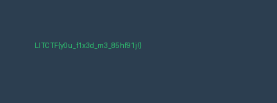

# faulty image 1 haha

**Category:** Crypto / Misc (file forensics) · **Points:** 252 · **Solves:** 27 · **Author:** Ninjaprime

**Flag:** `LITCTF{y0u_f1x3d_m3_85hf91j!}`

## Challenge

> haha Someone tampered with an image haha, and now we can't view it haha! Help the
> LIT team recover the image haha!

Provided file: [`corrupt.png`](corrupt.png) (2304 bytes) — won't open in any viewer.

## Recon

Hexdump the header — the PNG structure is *mostly* fine:

```
89 50 4e 47 0d 0a 1a 0a                          <- valid PNG signature
00 00 00 0d 49 48 44 52  00 00 01 90 00 00 00 96  <- IHDR len=13, 400 x 150
08 02 00 00 00 7f f3 49 32                        <- 8-bit, colortype 2 (RGB), CRC OK
00 00 08 6b 49 44 41 54  78 9c ...                <- IDAT len=2155, zlib 78 9c...
```

The signature and **IHDR are valid** (its CRC checks out, so `400x150 RGB8` is
trustworthy). But the **IDAT CRC is wrong** and the zlib stream fails to decompress.

Scanning the whole file for the obvious "haha" (`68 61 68 61`) that the prompt keeps
repeating reveals the trick — the markers are **perfectly periodic**:

```
haha offsets: 100, 204, 308, 412, 516, 620, ... , 1972, 2076, 2180   (step = 104)
```

So `haha` was **inserted after every 100 bytes** of the original file. Each of those
4-byte insertions shifts everything downstream, which is exactly why the IDAT stream
(and its CRC) breaks.

## Solution

Walk the file in **104-byte blocks**, keep the first 100 bytes of each block, and drop
the trailing 4-byte `haha`:

```python
orig = b"".join(data[i:i+100] for i in range(0, len(data), 104))
```

This reproduces the original byte-for-byte: the recovered IDAT decompresses to exactly
`150 * (1 + 400*3) = 180150` bytes with **zero** leftover — a clean, complete image.
Rebuild the PNG (fresh IDAT + IEND with correct CRCs) and open it:



The image simply renders the flag as text.

> The `70 83 60 01` filler and extra `haha` seen near the end of the file sit *after*
> the real 2155-byte IDAT payload — leftover tamper padding, harmless once the stream
> is realigned.

## Flag

```
LITCTF{y0u_f1x3d_m3_85hf91j!}
```
